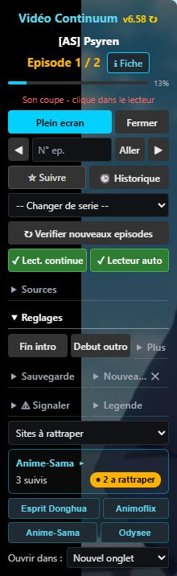
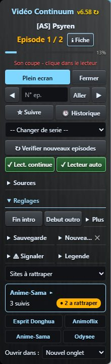
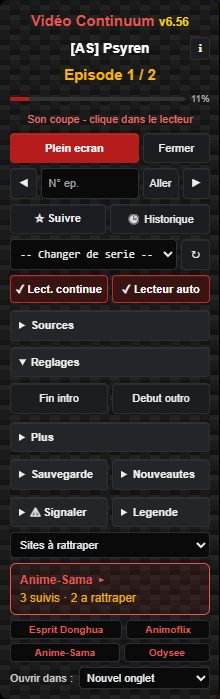
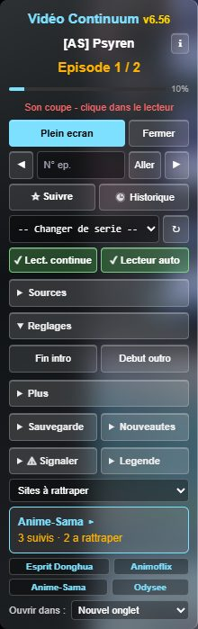
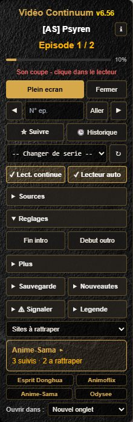
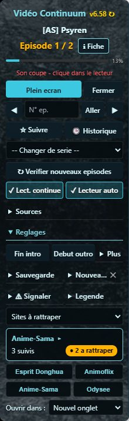

# Thèmes du panneau (v6.56)

Choix du thème dans le panneau : **Réglages → Plus → Thème**. Le lecteur et le panneau du site prennent le même thème, et le choix est gardé dans la sauvegarde.

Tampermonkey télécharge tout seul les textures avec le script (`@resource`) : rien à installer à la main. Les fichiers sont ici pour qui veut les récupérer (clic sur le lien, puis bouton *Download raw file*).

| Thème | Aperçu | Accent | Texture |
|---|---|---|---|
| Actuel |  | cyan | aucune |
| Métallique |  | bleu glacier | [metal.jpg](metal.jpg) (titane brossé, 300×900) |
| Fibre de carbone |  | rouge sombre | aucune (trame dessinée en CSS) |
| Verre trempé |  | cyan clair | aucune (flou de la vidéo derrière le panneau) |
| Pierre noire |  | or | [pierre-noire.jpg](pierre-noire.jpg) (ardoise, 300×900) |
| Pierre bleue |  | turquoise | [pierre-bleue.jpg](pierre-bleue.jpg) (pierre bleu-noir, 300×900) |

Les couleurs d'état ne changent pas d'un thème à l'autre : orange = épisodes à rattraper, vert = suivi / actif, violet = saison finie en attente.

**Verre trempé** floute la vidéo en continu : sur une machine modeste, si la lecture saccade, choisis un autre thème.

## Police Cinzel (titres, option « Titres en Cinzel »)

`cinzel.woff2` : Cinzel (graisse 600, caractères latins), © The Cinzel Project Authors,
sous licence SIL Open Font License 1.1 — texte complet dans [`OFL-Cinzel.txt`](OFL-Cinzel.txt).
Livrée avec le script via `@resource`, comme les textures.
